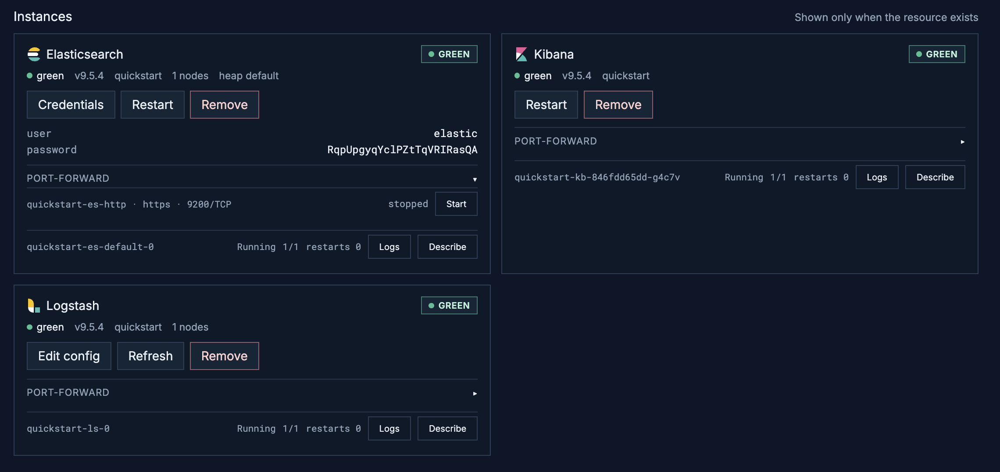
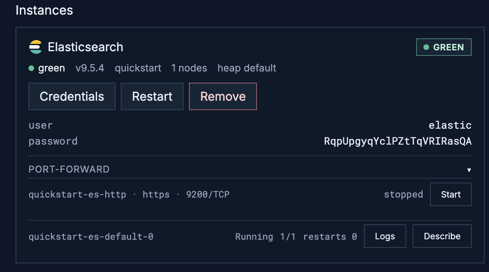
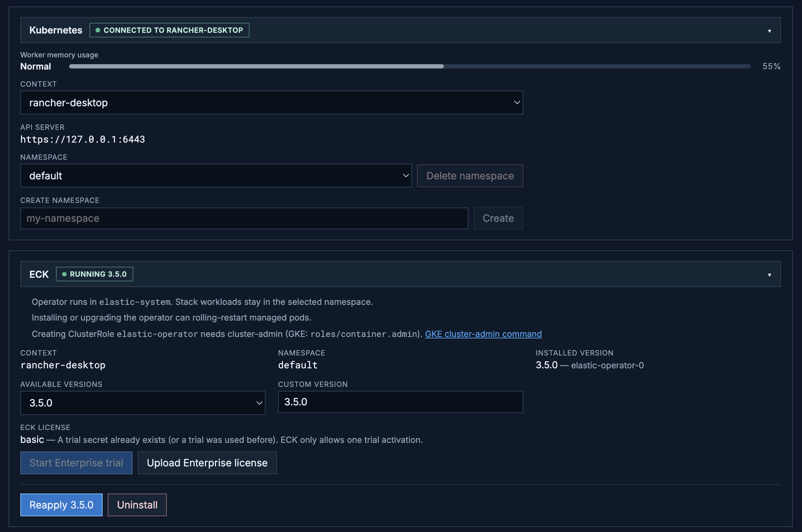
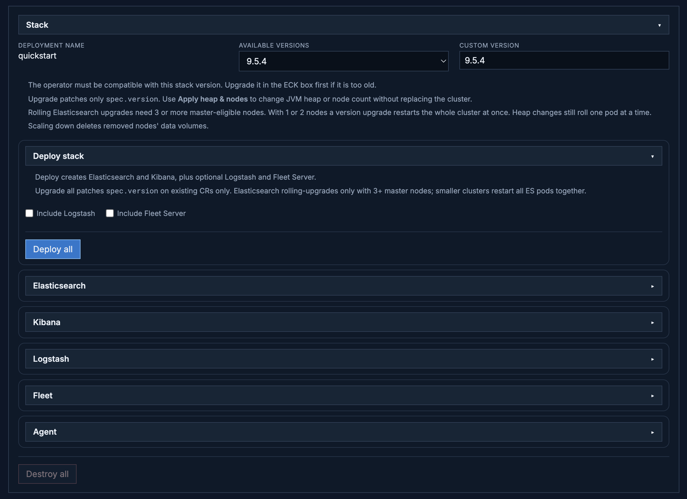

# YAEU

**Yet Another ECK UI.** Local web UI for running an [Elastic Cloud on Kubernetes (ECK)](https://www.elastic.co/docs/deploy-manage/deploy/cloud-on-k8s) **quickstart** stack against the cluster in your kubeconfig.

It talks to Kubernetes through `kubectl`’s config (`~/.kube/config`). You can install the ECK operator, deploy Elasticsearch / Kibana / Logstash / Fleet Server / Elastic Agent as `quickstart` resources, change stack version, scale Elasticsearch, port-forward to ES and Kibana, and tear the stack down again.

This is a laptop/lab tool, not a production control plane.

## What it does

- **Kubernetes** — pick kube context and namespace, create/delete namespaces, see how much RAM is already **requested** on the node (what the scheduler will allow, not live RSS).
- **ECK** — install, upgrade, switch, or uninstall the operator from official YAML on `download.elastic.co`. Optional Enterprise trial.
- **Stack** — pick a stack version (from Elastic’s artifacts API, or type a custom one). Deploy or upgrade Elasticsearch, Kibana, Logstash, Fleet Server, and Elastic Agent, or the full quickstart. Elasticsearch heap and node count can be applied without replacing the cluster.
- **Instances** — health, pods, logs, `elastic` password, and start/stop port-forward to `https://localhost:9200` and `https://localhost:5601`.
- **Destroy all** — delete the quickstart resources and their PVCs in the selected namespace.

Mutating actions (deploy, upgrade, stop, apply heap/nodes, operator install, and similar) ask for confirmation first.

Resource name is always `quickstart`. Elasticsearch uses `node.store.allow_mmap: false` so it can run on typical local Kubernetes (Rancher Desktop, kind, Colima, and so on).

## Screenshots

Overview — kube context, operator status, and instance cards (health, pods, logs, describe):



Elasticsearch instance — credentials, port-forward, pod logs and describe:



Kubernetes connection and ECK operator (version, trial, reapply):



Stack — pick a version, deploy individual products or the full quickstart:



## Requirements

- **Node.js 20+** and npm
- **`kubectl`** on your `PATH`, with a working kubeconfig (`kubectl get nodes` succeeds)
- A **Kubernetes cluster** you are allowed to use (local single-node is fine)
- Ability to **pull Elastic images** (`docker.elastic.co/...`) from the cluster
- Enough **node RAM** for the topology you pick (a 2–3 node Elasticsearch cluster plus Kibana is several GiB of *requests*; raise the VM memory in Rancher Desktop if pods stay `Pending`)

You do **not** need the ECK operator installed beforehand **if** your user can create cluster-scoped RBAC (see [Installing the operator](#installing-the-operator)).

The API binds to `127.0.0.1` only. Scripts and other tools can call the same routes the UI uses (see [HTTP API](#http-api)).

## Install and run

From the repo root:

```bash
npm install
npm run dev
```

| | URL |
| --- | --- |
| UI | http://127.0.0.1:5173 |
| API | http://127.0.0.1:8787 |

Leave that process running. Vite proxies `/api` to the server.

Optional: `PORT=8787` changes the API port (the Vite proxy still expects `8787` unless you change `web/vite.config.ts`).

### Production-style build

```bash
npm run build
npm start
```

`npm start` serves **only the API** on port 8787. For day-to-day use, prefer `npm run dev`.

## First-time walkthrough

1. Open http://127.0.0.1:5173.
2. **Kubernetes** — confirm the context is the cluster you want and pick a namespace (default `default`). Protected namespaces (`default`, `kube-system`, `kube-public`, `kube-node-lease`, `elastic-system`) cannot be deleted from the UI.
3. **ECK** — if the operator is not running, choose a version (default is a recent 3.x) and install it. Wait until the badge shows it is running.
4. **Stack** — choose a stack version (for example `9.5.2`). Deploy Elasticsearch first (or **Deploy stack**). For a **rolling** Elasticsearch version upgrade, use **3 or more** master-eligible nodes; 1–2 nodes restart together (no quorum).
5. When Elasticsearch is green, deploy Kibana (and optionally Logstash / Fleet).
6. On the **Elasticsearch** instance card, start the port-forward, then **Open Kibana** (or open `https://localhost:5601`). Accept the self-signed cert. Password is under **Access credentials** (from secret `quickstart-es-elastic-user`).

Browsers keep Kibana Dev Tools history in **localStorage** for `https://localhost:5601`. Destroying the cluster does not clear that; use Console → History, or clear site data for that origin.

## Installing the operator

The official operator manifest creates ClusterRole `elastic-operator` with cluster-wide permissions. Kubernetes **will not** let you create that role unless you already have those permissions (privilege escalation prevention).

On **GKE**, a Google account that can only work in a namespace typically gets `403 Forbidden` on install. You need `roles/container.admin` (or a `cluster-admin` ClusterRoleBinding), or ask someone who has that to apply the manifests:

```bash
kubectl apply -f https://download.elastic.co/downloads/eck/3.5.0/crds.yaml
kubectl apply -f https://download.elastic.co/downloads/eck/3.5.0/operator.yaml
```

Use the same operator version you selected in the UI. After the operator is running in `elastic-system`, YAEU can deploy stack resources with ordinary namespace permissions.

## Upgrades and Elasticsearch topology

- **Upgrade** patches only `spec.version`. Heap, node count, and Logstash pipelines stay as they are.
- **Apply heap & nodes** changes JVM heap (`ES_JAVA_OPTS`, pod memory ≈ 2× heap) and `nodeSets` count. Scaling **down** deletes the extra nodes’ data volumes (`DeleteOnScaledownAndClusterDeletion`).
- Elasticsearch **cannot be downgraded** onto existing data directories; the UI blocks that.

## Smoke-test the cluster

With `kubectl` pointing at the same cluster:

```bash
npm run test:cluster
```

| Env | Meaning |
| --- | --- |
| `NAMESPACE` | Namespace to check (default `default`) |
| `KUBE_CONTEXT` | Override kube context |
| `SKIP_HTTP=1` | CR/pod checks only; no port-forward |

Pass means the Elasticsearch CR exists, ES health is green or yellow over HTTPS, relevant pods are Running, and Kibana `/api/status` is 200 when Kibana is deployed.

## Layout

```
yaeu/
  server/   Fastify API + Kubernetes client
  web/      Vite + React UI
  scripts/  cluster smoke test
  docs/     README screenshots
```

## HTTP API

The UI is a client of `http://127.0.0.1:8787`. Confirm dialogs are UI-only; the API does not prompt. There is no “start a stopped CR”: **Remove** deletes the resource, **Deploy** creates it again (`POST`).

Use `npm run dev` for UI + API, or `npm start` after `npm run build` for API only. Check the server with `GET /api/health`.

Conventions:

- Bind is localhost only.
- Default namespace is `default`. Pass `?namespace=` on resource calls.
- Resource name is always `quickstart`.
- Heap values need units (`512m`, `1g`, `4g`). A bare `4` is rejected.
- `GET /api/elasticsearch` returns `heapSize` when `ES_JAVA_OPTS` is set on the default nodeSet (configured JVM heap for pod creation, not live RSS).

### Routes

| Action | Method | Path |
| --- | --- | --- |
| Health | GET | `/api/health` |
| Cluster / memory | GET | `/api/cluster`, `/api/cluster/memory` |
| Switch kube context | POST | `/api/cluster/context` |
| Namespaces | POST DELETE | `/api/namespaces`, `/api/namespaces/:name` |
| ECK operator | GET POST DELETE | `/api/eck/operator` |
| License | GET POST | `/api/eck/license`, `/api/eck/license/trial` |
| Credentials | GET | `/api/credentials?namespace=` |
| Elasticsearch | GET POST PATCH DELETE | `/api/elasticsearch` |
| Restart ES pods | POST | `/api/elasticsearch/restart` |
| Kibana / Logstash / Fleet / Agent | GET POST PATCH DELETE | `/api/kibana`, `/api/logstash`, `/api/fleet-server`, `/api/elastic-agent` |
| Deploy / upgrade / destroy stack | POST POST DELETE | `/api/quickstart/deploy-all`, `/api/quickstart/upgrade`, `/api/quickstart` |
| Port-forward | GET POST DELETE | `/api/port-forward`, `/api/port-forward/:target` |
| Pod logs / describe | GET | `/api/pods/:name/logs`, `/api/pods/:name/describe` |
| Beats (no UI) | GET POST DELETE | `/api/beats` |
| StackConfigPolicy (no UI) | GET POST DELETE | `/api/stack-config-policy` |
| Sidecar monitoring (no UI) | GET POST DELETE | `/api/monitoring/sidecar` |

Port-forward `target` values: `es`, `kibana`, or `svc:<service>:<port>`.

PATCH Elasticsearch topology: `{ "heapSize": "4g", "nodeCount": 1 }`.

Beats POST may include `{ "version": "9.4.5", "includePacketbeat": false }`. Version defaults to the Elasticsearch CR.

Sidecar POST body: `{ "target": "self" }` (default) or `"quickstart-monitor"` if that ES CR already exists.

StackConfigPolicy needs ECK 2.6+ and an Enterprise or trial license.

Destroy-all (`DELETE /api/quickstart`) also removes Fleet, Beats, StackConfigPolicy, sidecar monitoring, and PVCs. Restart deletes pods; the CR stays.

### curl examples

Replace `default` if you use another namespace.

```bash
# Status and credentials
curl -s http://127.0.0.1:8787/api/health
curl -s 'http://127.0.0.1:8787/api/cluster'
curl -s 'http://127.0.0.1:8787/api/elasticsearch?namespace=default'
curl -s 'http://127.0.0.1:8787/api/credentials?namespace=default'

# Deploy and topology
curl -s -X POST 'http://127.0.0.1:8787/api/elasticsearch?namespace=default' \
  -H 'Content-Type: application/json' \
  -d '{"version":"9.4.5","heapSize":"4g","nodeCount":1}'

curl -s -X PATCH 'http://127.0.0.1:8787/api/elasticsearch?namespace=default' \
  -H 'Content-Type: application/json' \
  -d '{"heapSize":"4g","nodeCount":1}'

curl -s -X POST 'http://127.0.0.1:8787/api/kibana?namespace=default' \
  -H 'Content-Type: application/json' \
  -d '{"version":"9.4.5"}'

curl -s -X POST 'http://127.0.0.1:8787/api/quickstart/deploy-all?namespace=default' \
  -H 'Content-Type: application/json' \
  -d '{"version":"9.4.5","includeLogstash":false,"includeFleetServer":false,"heapSize":"4g","nodeCount":1}'

# Restart, remove, destroy
curl -s -X POST 'http://127.0.0.1:8787/api/elasticsearch/restart?namespace=default'
curl -s -X DELETE 'http://127.0.0.1:8787/api/elasticsearch?namespace=default'
curl -s -X DELETE 'http://127.0.0.1:8787/api/quickstart?namespace=default'

# Port-forward, logs, describe
curl -s -X POST 'http://127.0.0.1:8787/api/port-forward/es' \
  -H 'Content-Type: application/json' \
  -d '{"namespace":"default"}'
curl -s -X POST 'http://127.0.0.1:8787/api/port-forward/kibana' \
  -H 'Content-Type: application/json' \
  -d '{"namespace":"default"}'
curl -s http://127.0.0.1:8787/api/port-forward
curl -s -X DELETE http://127.0.0.1:8787/api/port-forward/es

curl -s 'http://127.0.0.1:8787/api/pods/quickstart-es-default-0/logs?namespace=default&tailLines=200'
curl -s 'http://127.0.0.1:8787/api/pods/quickstart-es-default-0/describe?namespace=default'

# Add-ons (API only)
curl -s -X POST 'http://127.0.0.1:8787/api/beats?namespace=default' \
  -H 'Content-Type: application/json' \
  -d '{"includePacketbeat":true}'
curl -s -X POST 'http://127.0.0.1:8787/api/stack-config-policy?namespace=default'
curl -s -X POST 'http://127.0.0.1:8787/api/monitoring/sidecar?namespace=default' \
  -H 'Content-Type: application/json' \
  -d '{"target":"self"}'
```
